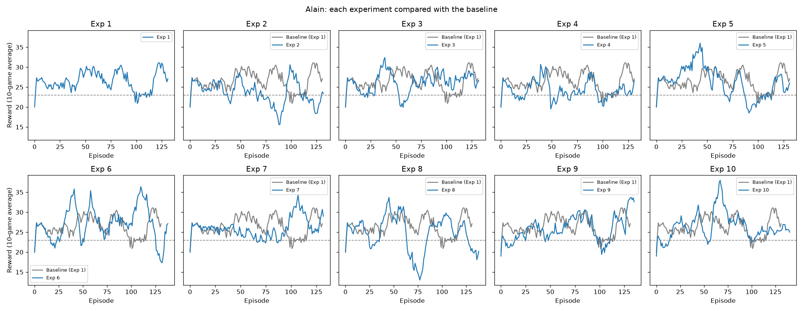
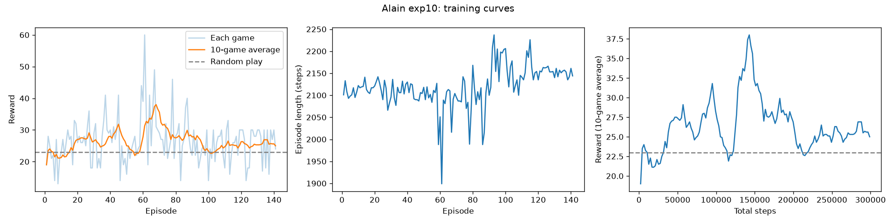

# Hyperparameter Experiment Results by Alain

**Game:** Bowling (`ALE/Bowling-v5`), 10 frames per game, one point per pin plus strike and spare bonuses.

**Reference scores:** random play about 23 · published DQN 42.4 (DeepMind, 50M frames) · maximum 300 (12 strikes).

**Fixed for every run:** 300,000 steps, replay buffer 50,000, learning starts at 10,000, train every 4 steps, target network update every 1,000 steps, Adam + Huber loss, seed 42.

**How each run was judged:**
- **Training avg:** average reward over all training games (includes random exploration moves).
- **Plays:** average score of the saved model over 3 games with no random moves, exactly like `play.py` (from `select_best.py` and `greedy_check.py`).
- **Plot:** rewards, episode length and steps per experiment (`expNN/training_plot.png`).

## Results

| Exp | lr | gamma | batch | eps start | eps end | eps decay | Training avg | Plays | Observed behaviour |
|---|---|---|---|---|---|---|---|---|---|
| 1 | 1e-4 | 0.99 | 32 | 1.0 | 0.05 | 100,000 | 26.6 | 0 | Baseline. Just above random; the 10-game average moved between 23 and 31 with no steady rise. Saved model presses NOOP and never throws. |
| 2 | 1e-5 | 0.99 | 32 | 1.0 | 0.05 | 100,000 | 23.6 | 30 | Smallest updates. Learned slowly, with a dip to about 16 near game 88, but the saved model is stable: it finishes every game with 30 using UP 56%, UPFIRE 34%, FIRE 9%. |
| 3 | 5e-4 | 0.99 | 32 | 1.0 | 0.05 | 100,000 | 26.3 | 0 | Largest updates. Fast early peak (31.3 in games 31–46, best game 52), then fell to 21.5 in games 47–60. Saved model rolls every ball into the gutter (DOWNFIRE). Steps too large make it forget what it learned. |
| 4 | 1e-4 | 0.99 | 16 | 1.0 | 0.05 | 100,000 | 24.5 | 0 | Noisier updates. Best game 70 and 27.7 in games 31–46, but fell to 21.3 once epsilon reached 0.05, and games got longer (2,132 -> 2,336 steps). Saved model presses UP and never throws. |
| 5 | 1e-4 | 0.99 | 64 | 1.0 | 0.05 | 100,000 | 26.4 | 30 | Smoother updates. Best early stretch of all runs (33.8 in games 31–46, best game 61). Fell to about 25 after epsilon reached 0.05. Saved model presses UPFIRE every step and scores 30. |
| 6 | 1e-4 | 0.95 | 32 | 1.0 | 0.05 | 100,000 | 27.3 | 6 | Short horizon (about 20 steps). Most consistent training, with no drop at the epsilon minimum, and games stayed short (about 2,150 steps): waiting costs more, so it throws quickly. Last 20 games fell to 23; saved model throws mostly into the gutter (0–12 per game). |
| 7 | 1e-4 | 0.995 | 32 | 1.0 | 0.05 | 100,000 | 26.1 | 0 | Long horizon (about 200 steps). Flat training around 26 with no peak. Waiting costs almost nothing, so games got longer (2,136 -> 2,301 steps). Saved model presses DOWN and never throws. |
| 8 | 1e-4 | 0.95 | 64 | 1.0 | 0.05 | 100,000 | 24.6 | 0 | Combined the two best single changes (Exp 5 + Exp 6). Still threw quickly, but training collapsed to 17.4 in games 61–80. Saved model throws into the gutter (DOWNFIRE 62%, NOOP 33%). The two changes did not add up. |
| 9 | 1e-4 | 0.99 | 64 | 1.0 | 0.05 | 200,000 | 26.1 | 0 | Slower exploration moved the drop from game 47 to game 94, when epsilon reached 0.05. Recovered to 30.0 in the last 23 games, with the best game of all runs (72). Saved model presses UP and never throws: the high training scores came from the random moves doing the throwing. |
| 10 | 5e-5 | 0.99 | 64 | 1.0 | 0.05 | 200,000 | 26.5 | **30** | Calmer updates plus Exp 9's slower exploration. Best long stretch (31.0 in games 59–90, best game 60) and the steadiest run after epsilon reached 0.05 (25.2 average, spread 5.3 against 8–12 for the others). Saved model scores 30 in 10 of 10 games using NOOP 42%, UPFIRE 23%, FIRE 22%. |

## Effect of each hyperparameter

- **Learning rate:** controls the size of each update. 5e-4 learned fast and then forgot (gutter). 1e-5 was stable but too slow in 300k steps. 5e-5 (Exp 10) was the best balance.
- **Batch size:** controls how noisy each update is. 16 gave lucky high games (70) but a model that stalls. 64 gave the best early learning and a saved model that plays.
- **Gamma:** decides whether the agent throws or waits. 0.95 makes waiting costly, so it throws quickly but aims badly. 0.995 makes waiting free, so games get longer and the model stalls. 0.99 worked best.
- **Epsilon decay:** in every run at lr 1e-4, scores dropped right after epsilon reached its minimum. A decay of 200,000 moved that drop later (Exp 9), and combined with calmer updates it kept the run steady (Exp 10).
- **Epsilon start / end:** kept at 1.0 -> 0.05 in all runs. eps start only changes the first 20 or so games, so we spent the runs on the settings that changed the final model.

## Best experiment: Exp 10

Exp 10 is the only run that is both stable in training and has a saved model that plays. `select_best.py` ranks the experiments by how the saved model plays, and breaks ties with the training average after epsilon reached its minimum:

| Rank | Exp | Plays | Training avg (after eps floor) |
|---|---|---|---|
| 1 | 10 | 30.0 | 25.2 |
| 2 | 5 | 30.0 | 24.6 |
| 3 | 2 | 30.0 | 22.8 |
| 4 | 6 | 6.0 | 27.9 |
| 5–10 | 1, 9, 7, 3, 4, 8 | 0.0 | 26.7 – 23.7 |

The training average alone would have picked Exp 6, whose saved model scores 0–12. Exp 9 ended training at 30 but its saved model never throws. Training averages include random moves and earlier weights, so we judged every run by the saved model itself.

## Worst experiment: Exp 8

Its training dropped furthest below random play (17.4 in games 61–80), and its saved model scores 0. It shows that hyperparameters interact: two changes that each helped on their own made things worse together.

## Limitations

Our best model scores 30: above random play (23) but below the published DQN (42.4) and far from the maximum (300). It found one safe throw (about 3 pins per frame) and repeats it. Reasons:
- **Short training:** 300k steps is about 1/40 of the 50M frames behind the published result.
- **Delayed reward:** points arrive long after the throw, so linking a button to the result is hard.
- **Precise strikes:** a strike needs a well-timed curve, which random exploration rarely finds.

## Final configuration

**lr 5e-5 - gamma 0.99 - batch 64 - eps 1.0 -> 0.05 · eps decay 200,000** (Exp 10).
Best model: `best_model/dqn_model.pth`. Notebook with all runs: `Alain_experiments.ipynb`.