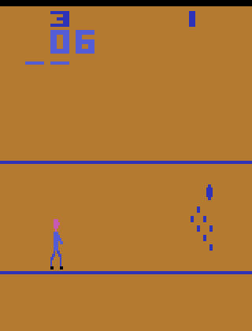
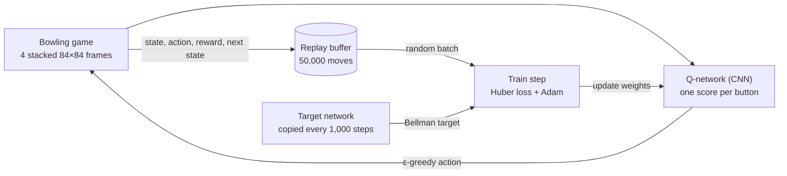
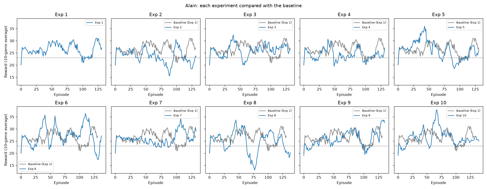
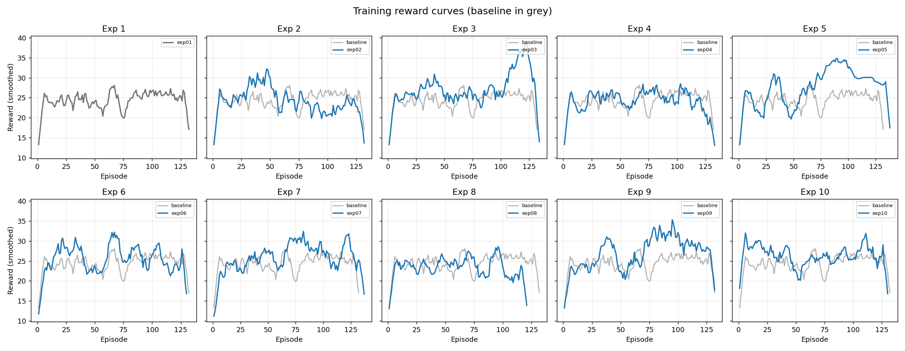
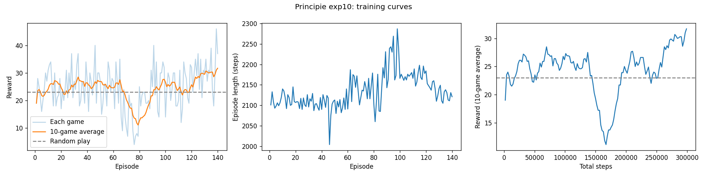

# Deep Q-Learning on Atari Bowling

A Deep Q-Network (DQN) built **from scratch** in PyTorch that learns to play Atari 2600 Bowling from raw pixels.
30 hyperparameter experiments across three team members, one champion agent.


<p align="center">
  
  <br>
  <em>The champion agent playing with no random moves.</em>
</p>


---

## Contents

1. [Highlights](#highlights)
2. [The game](#the-game)
3. [How our DQN works](#how-our-dqn-works)
4. [Repository structure](#repository-structure)
5. [Getting started](#getting-started)
6. [Training setup](#training-setup)
7. [Experiments](#experiments)
8. [Results](#results)
9. [What we learned](#what-we-learned)
10. [Limitations and next steps](#limitations-and-next-steps)
11. [Team](#team)
12. [References](#references)

---

## Highlights

- **No RL libraries.** Replay buffer, target network, epsilon-greedy and Bellman updates are all written by hand. No Stable-Baselines3, RLlib, CleanRL or TorchRL.
- **30 experiments.** Each member tuned learning rate, gamma, batch size and the epsilon schedule (10 runs each).
- **Champion beats random play.** It averages 31.5 points over 10 games against 23.1 for random play, and reaches 50 in its best game.
- **Honest evaluation.** Every model is judged by how it plays with no random moves, not by its training score.

---

## The game

| | |
|---|---|
| **Environment** | `ALE/Bowling-v5` (Gymnasium + Arcade Learning Environment) |
| **Goal** | Knock down as many pins as possible over 10 frames |
| **Actions** | 6 buttons: `NOOP`, `FIRE`, `UP`, `DOWN`, `UPFIRE`, `DOWNFIRE` |
| **Reward** | Points from pins, strikes and spares (maximum 300 per game) |
| **Game length** | About 2,100 to 2,600 agent steps |

**Reference scores**

| Player | Score per game |
|---|---|
| Random play | 23.1 |
| Published DQN (DeepMind, 50M frames) | 42.4 |
| Perfect game (12 strikes) | 300 |

**Why Bowling is hard**

- Points arrive long after the throw, so linking a button to its result is difficult.
- A strike needs a well-timed curve, which random play rarely finds.
- One safe throw already beats random play, so the agent can settle for it.

---

## How our DQN works



**Preprocessing** (`make_env` in `train.py`)

- Grayscale, resized to 84×84
- 4 game frames per agent step (frame skip)
- Last 4 frames stacked, so the network can see the ball moving

**Network** (`QNetwork` in `train.py`)

| Layer | Output | Details |
|---|---|---|
| Input | 4 × 84 × 84 | Pixels scaled from 0–255 to 0–1 |
| Conv 1 | 32 × 20 × 20 | 8×8 kernel, stride 4, ReLU |
| Conv 2 | 64 × 9 × 9 | 4×4 kernel, stride 2, ReLU |
| Conv 3 | 64 × 7 × 7 | 3×3 kernel, stride 1, ReLU |
| Fully connected | 512 | ReLU |
| Output | 6 | One Q-value per button |

We use a CNN rather than an MLP because the input is an image: convolutions find the lane, ball and pins wherever they appear.

**Learning rule**

$$y = r + \gamma \,(1 - \text{done}) \max_{a'} Q_{\text{target}}(s', a')$$

- **Replay buffer:** learns from random past moves, not only the latest ones, which breaks the link between consecutive frames.
- **Target network:** a frozen copy of the Q-network that gives stable targets. It is refreshed every 1,000 steps.
- **Epsilon-greedy:** epsilon falls linearly from start to end. Early moves are random (explore); later moves follow the network (exploit).
- **Huber loss:** behaves like squared error for small errors and absolute error for large ones, so one bad target cannot blow up an update.

---

## Repository structure

```
bowling-env_deep-q-learning/
├── train.py               # DQN agent: environment, network, replay buffer, training loop
├── play.py                # Watch a trained agent play (game window, greedy actions)
├── greedy_check.py        # Play a saved model without a window and count its buttons
├── select_best.py         # Rank experiments by how their saved models play
├── summary.py             # Average reward and best game of one experiment
├── plot_results.py        # Training plots for one experiment, or all against the baseline
├── pyproject.toml, uv.lock, .python-version   # Packages, managed by uv
├── assets/champion_play.gif
├── Champion_model/        # The group's best model, loaded by play.py
│   ├── dqn_model.pth
│   └── training_plot.png
├── Baseline/exp01/        # Shared baseline run
├── Alain/                 # One folder per member
│   ├── exp01/ … exp10/    # episodes.csv, dqn_model.pth, training_plot.png
│   ├── best_model/dqn_model.pth
│   ├── reward_curves.png
│   ├── alain_experiments.ipynb
│   └── Alain_Hyperparameter_experiment_results.md
├── Principie/             # Experiments, best model and results file
└── Francis/               # Experiments, best model, results file, notebook/ and comparison_grid.png
```

---

## Getting started

**1. Install uv** (once)

```bash
# macOS / Linux
curl -LsSf https://astral.sh/uv/install.sh | sh

# Windows (PowerShell)
powershell -c "irm https://astral.sh/uv/install.ps1 | iex"
```

**2. Get the code and the packages**

```bash
git clone https://github.com/ai-ngabo/bowling-env_deep-q-learning.git
cd bowling-env_deep-q-learning
uv sync
```

`uv sync` installs Python 3.14 and the exact package versions in `uv.lock`.

**3. Watch the champion play**

```bash
uv run play.py                                        # champion model, 1 game
uv run play.py --games 3                              # several games
uv run play.py --model Alain/exp10/dqn_model.pth      # any other model
```

`play.py` opens a game window and always picks the button with the highest Q-value. Run it on a computer with a screen, not on Kaggle.

**4. Train an experiment**

```bash
uv run train.py --member Alain --exp 10 --lr 5e-5 --gamma 0.99 --batch-size 64 \
                --eps-start 1.0 --eps-end 0.05 --eps-decay 200000
```

| Flag | Meaning | Default |
|---|---|---|
| `--member` | Folder to save into | required |
| `--exp` | Experiment number (saved as `expNN`) | required |
| `--lr` | Learning rate | 1e-4 |
| `--gamma` | Discount factor | 0.99 |
| `--batch-size` | Moves per update | 32 |
| `--eps-start` / `--eps-end` | Epsilon at the start / end | 1.0 / 0.05 |
| `--eps-decay` | Steps for epsilon to go from start to end | 100,000 |
| `--total-steps` | Training length | 300,000 |

Each run saves `episodes.csv` (one row per game), `dqn_model.pth` and, after plotting, `training_plot.png`.

**5. Check the results**

| Script | What it does | Example |
|---|---|---|
| `summary.py` | Average reward and best game of one run | `uv run summary.py --member Alain --exp 10` |
| `plot_results.py` | Rewards, episode length and steps of one run | `uv run plot_results.py --member Alain --exp 10` |
| `plot_results.py` | All 10 runs against the baseline | `uv run plot_results.py --member Alain` |
| `greedy_check.py` | Plays the saved model with no random moves and counts buttons | `uv run greedy_check.py --member Alain --exp 10 --games 10` |
| `select_best.py` | Ranks runs by how the saved models play and copies the best | `uv run select_best.py --member Alain` · `--all` |

**Training on Kaggle:** a 300,000-step run takes about 12 minutes on a T4 GPU. Use T4, not P100: current PyTorch no longer supports the P100.

---

## Training setup

**Fixed for every experiment** (so results are comparable)

| Setting | Value |
|---|---|
| Training length | 300,000 agent steps (about 135 games) |
| Replay buffer | 50,000 moves |
| Learning starts after | 10,000 steps |
| Update frequency | Every 4 steps |
| Target network update | Every 1,000 steps |
| Optimizer / loss | Adam / Huber |
| Seed | 42 |

**Baseline (Exp 1 for everyone)**

| lr | γ | Batch | ε start | ε end | ε decay |
|---|---|---|---|---|---|
| 1e-4 | 0.99 | 32 | 1.0 | 0.05 | 100,000 |

---

## Experiments

Each member ran 10 experiments. All numbers come from each run's `episodes.csv`.

- **Avg:** average reward over all training games
- **Last 20:** average of the final 20 games
- **Best:** highest single game

Full observations and reasoning are in each member's results file.

<details>
<summary><b>Alain</b>: one change at a time, then combinations · <a href="Alain/alain_hyperparameter_experiment_results.md">full results</a></summary>

| Exp | lr | γ | Batch | ε start | ε end | ε decay | Avg | Last 20 | Best | Observation |
|---|---|---|---|---|---|---|---|---|---|---|
| 1 | 1e-4 | 0.99 | 32 | 1.0 | 0.05 | 100k | 26.6 | 28.9 | 50 | Baseline; final model never throws |
| 2 | 1e-5 | 0.99 | 32 | 1.0 | 0.05 | 100k | 23.6 | 22.6 | 49 | Slow, but final model plays (30) |
| 3 | 5e-4 | 0.99 | 32 | 1.0 | 0.05 | 100k | 26.3 | 27.9 | 52 | Peaked early, then forgot |
| 4 | 1e-4 | 0.99 | 16 | 1.0 | 0.05 | 100k | 24.5 | 26.2 | 70 | Noisy updates; final model stalls |
| 5 | 1e-4 | 0.99 | 64 | 1.0 | 0.05 | 100k | 26.4 | 26.9 | 61 | Best early learning; plays 30 |
| 6 | 1e-4 | 0.95 | 32 | 1.0 | 0.05 | 100k | 27.3 | 23.2 | 55 | Throws fast, aims badly |
| 7 | 1e-4 | 0.995 | 32 | 1.0 | 0.05 | 100k | 26.1 | 27.1 | 51 | Waits too long; stalls |
| 8 | 1e-4 | 0.95 | 64 | 1.0 | 0.05 | 100k | 24.6 | 21.0 | 51 | Combination collapsed |
| 9 | 1e-4 | 0.99 | 64 | 1.0 | 0.05 | 200k | 26.1 | 29.0 | 72 | Drop came later; final model stalls |
| **10** | 5e-5 | 0.99 | 64 | 1.0 | 0.05 | 200k | 26.5 | 25.2 | 60 | **Best: steadiest run, plays 30 every game** |


</details>

<details>
<summary><b>Principie</b>: kept each improvement and built on it · <a href="Principie/PrincipieHyperparameter_experiment_results.md">full results</a></summary>

| Exp | lr | γ | Batch | ε start | ε end | ε decay | Avg | Last 20 | Best | Observation |
|---|---|---|---|---|---|---|---|---|---|---|
| Base | 1e-4 | 0.99 | 32 | 1.0 | 0.05 | 100k | 24.8 | 25.7 | 48 | Baseline |
| 1 | 2.5e-4 | 0.99 | 32 | 1.0 | 0.05 | 100k | 24.8 | 26.4 | 46 | Higher lr: no gain |
| 2 | 5e-5 | 0.99 | 32 | 1.0 | 0.05 | 100k | 26.1 | 25.7 | 51 | Lower lr helped |
| 3 | 5e-5 | 0.997 | 32 | 1.0 | 0.05 | 100k | 26.1 | 27.0 | 52 | Longer horizon: small gain |
| 4 | 5e-5 | 0.999 | 32 | 1.0 | 0.05 | 100k | 26.1 | 26.8 | 51 | Horizon too long |
| 5 | 5e-5 | 0.997 | 64 | 1.0 | 0.05 | 100k | 27.6 | 26.0 | 54 | Bigger batch helped |
| 6 | 5e-5 | 0.997 | 128 | 1.0 | 0.05 | 100k | 29.3 | 34.1 | 55 | Best training scores |
| 7 | 5e-5 | 0.997 | 128 | 1.0 | 0.01 | 100k | 25.8 | 29.7 | 47 | Too little randomness |
| 8 | 5e-5 | 0.997 | 128 | 1.0 | 0.1 | 100k | 27.5 | 29.9 | 43 | More randomness: good |
| 9 | 5e-5 | 0.997 | 128 | 1.0 | 0.05 | 50k | 25.7 | 28.2 | 50 | Explored too briefly |
| **10** | 5e-5 | 0.997 | 128 | 1.0 | 0.05 | 200k | 24.6 | 30.6 | 46 | **Champion: still improving when training ended** |

</details>

<details>
<summary><b>Francis</b>: one change at a time from the baseline · <a href="Francis/FrancisHyperparameter_experiments_results_table.md">full results</a></summary>

| Exp | lr | γ | Batch | ε start | ε end | ε decay | Avg | Last 20 | Best | Observation |
|---|---|---|---|---|---|---|---|---|---|---|
| 1 | 1e-4 | 0.99 | 32 | 1.0 | 0.05 | 100k | 24.9 | 25.9 | 44 | Baseline |
| 2 | 5e-4 | 0.99 | 32 | 1.0 | 0.05 | 100k | 24.6 | 23.1 | 50 | Early peak, then decline |
| 3 | 1e-5 | 0.99 | 32 | 1.0 | 0.05 | 100k | 27.6 | 32.3 | 56 | Slow start, best late scores |
| 4 | 1e-4 | 0.95 | 32 | 1.0 | 0.05 | 100k | 24.6 | 22.6 | 64 | Short horizon hurt |
| **5** | 1e-4 | 0.99 | 64 | 1.0 | 0.05 | 100k | 28.1 | 29.1 | 49 | **Smoothest learning; his best model** |
| 6 | 1e-4 | 0.99 | 32 | 1.0 | 0.05 | 50k | 25.9 | 24.7 | 51 | Explored too briefly |
| 7 | 1e-4 | 0.99 | 32 | 1.0 | 0.05 | 200k | 26.2 | 28.3 | 48 | Stable, decent |
| 8 | 1e-4 | 0.99 | 32 | 1.0 | 0.01 | 100k | 23.8 | 21.7 | 45 | Too little randomness |
| 9 | 3e-4 | 0.99 | 64 | 1.0 | 0.05 | 100k | 27.4 | 28.7 | 58 | Batch 64 tamed the high lr |
| 10 | 1e-4 | 0.99 | 32 | 0.5 | 0.05 | 100k | 26.9 | 28.0 | 50 | Less early exploring: no gain |


</details>

---

## Results

**Final test:** each member's best model played 10 games with no random moves (`greedy_check.py`, games 1–10).

| Model | lr · γ · batch · ε decay | Avg | Range | Buttons it uses |
|---|---|---|---|---|
| 🏆 **Champion: Principie Exp 10** | 5e-5 · 0.997 · 128 · 200k | **31.5** | 11–50 | NOOP, DOWN, FIRE, DOWNFIRE |
| Francis Exp 5 | 1e-4 · 0.99 · 64 · 100k | 31.9 | 30–36 | UP, NOOP, FIRE, UPFIRE |
| Alain Exp 10 | 5e-5 · 0.99 · 64 · 200k | 30.0 | 30–30 | NOOP, UPFIRE, FIRE, UP |
| *Random play* | | *23.1* | | |
| *Published DQN* | *50M frames* | *42.4* | | |

**Why this champion**

- It had the highest score in the group's selection run (43.3 over 3 games).
- It's the only finalist that reached 50 in the final test.
- Its training curve was still rising when training stopped (plot below).

Over 10 games, the three finalists are within 2 points of each other. Francis's model is the most consistent; the champion has the highest ceiling.



**Reproduce the champion**

```bash
uv run train.py --member Principie --exp 10 --lr 5e-5 --gamma 0.997 --batch-size 128 \
                --eps-start 1.0 --eps-end 0.05 --eps-decay 200000
uv run greedy_check.py --member Principie --exp 10 --games 10
```

---

## What we learned

| Hyperparameter | What worked | What failed |
|---|---|---|
| **Learning rate** | 5e-5 and 1e-5: slow but stable. The champion and Alain's best both use 5e-5. | 5e-4 peaked early, then forgot what it learned (Alain, Francis). |
| **Batch size** | 64 and 128 gave smoother learning. All three best models use 64 or 128. | 16 gave lucky games but an unstable final model. |
| **Gamma** | 0.99–0.997 looked far enough ahead to link a throw to the pins. | 0.95 throws fast but aims badly (Alain, Francis); 0.995 stalled (Alain); 0.999 did worse than 0.997 (Principie). |
| **ε decay** | 200k: exploring longer gave the champion and Alain's best run. | 50k: too little exploring (Francis, Principie). |
| **ε end** | 0.05–0.1 kept some useful randomness. | 0.01 did worse in both runs; Francis's collapsed late in training. |
| **ε start** | 1.0 (fully random at first). | 0.5 gave no gain (Francis). |

**Two lessons beyond the numbers**

- **Training scores can mislead.** Training games still include random moves. Some models scored about 30 in training, but with no random moves they pressed one button all game and never threw. That's why we test every saved model with `greedy_check.py`.
- **3 games is not enough.** The champion scored 43.3 over 3 games but 31.5 over 10. Bowling scores vary a lot, so we report 10-game averages.

---

## Limitations and next steps

**Limitations**

- **Short training.** 300,000 steps is about 1/40 of the training behind the published DQN result.
- **Settles on safe throws.** Many final models found one safe throw (30 points a game, about 3 pins per frame) and kept repeating it.
- **One run per setting.** Some differences between experiments are within run-to-run noise.

**Next steps**

- Train the champion's settings for 1–2 million steps, since its curve was still rising.
- Try Double DQN or prioritized replay, which help with delayed rewards.
- Run each setting with 2–3 seeds to separate real effects from luck.

---

## Team

| Member | Code | Experiments and docs | Presentation |
|---|---|---|---|
| **Alain** | Repo and uv setup, `make_env`, replay buffer, CSV logging, CLI, `greedy_check.py` | 10 experiments, README, architecture diagram | Introduction |
| **Principie** | `QNetwork`, epsilon schedule and action selection, `play.py`, `select_best.py`, `summary.py` | 10 experiments, champion model, task allocation, gameplay video | Live demo |
| **Francis** | `train_step` (Bellman target, Huber loss, Adam), target network sync, training loop, model saving, `plot_results.py` | 10 experiments | DQN implementation |

📄 [Task allocation](assets/Task_Allocation.pdf)

---

## References

- Mnih et al. (2015). *Human-level control through deep reinforcement learning.* Nature 518, 529–533.
- Wang et al. (2016). *Dueling Network Architectures for Deep Reinforcement Learning.* [arXiv:1511.06581](https://arxiv.org/abs/1511.06581) (random-play baseline of 23.1)
- [Gymnasium: Bowling environment](https://ale.farama.org/environments/bowling/)
- [uv documentation](https://docs.astral.sh/uv/)